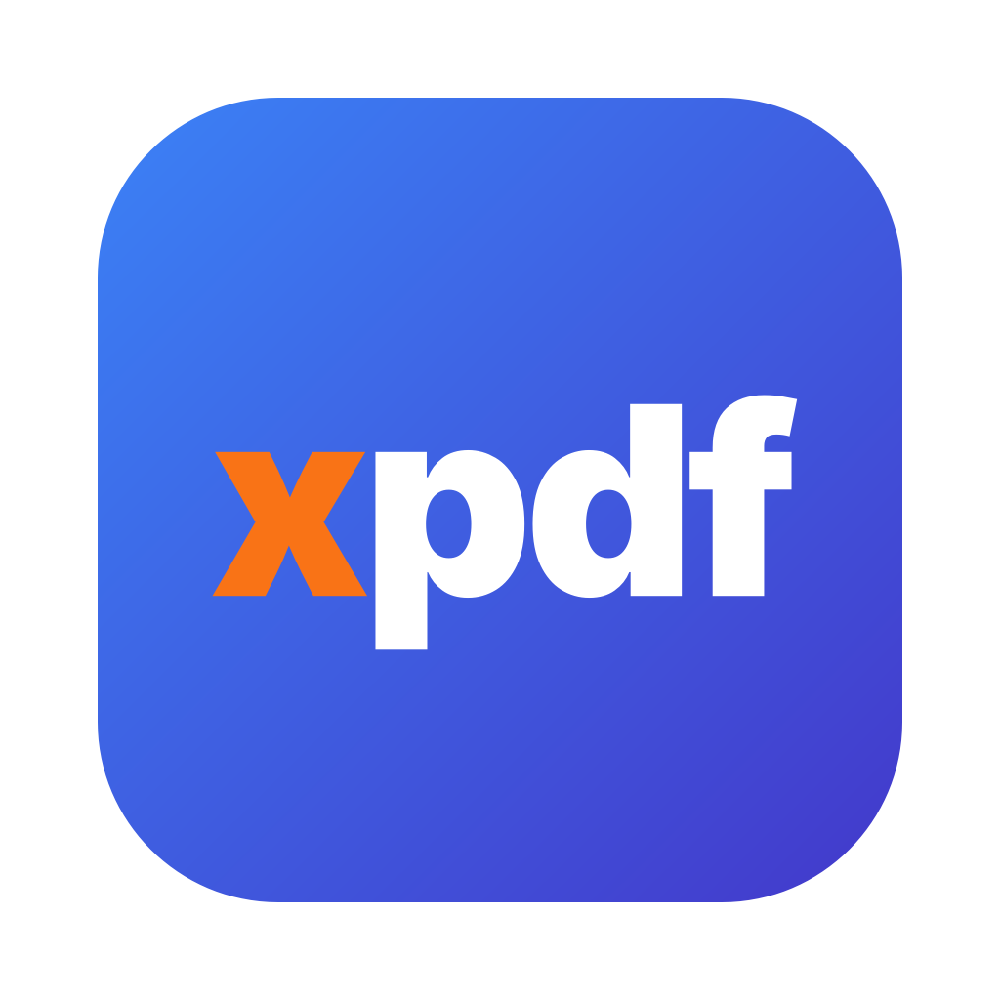

<div align="center">



# xpdf

**Editor de PDF de escritorio: pocas funciones, bien hechas.**

Edita el texto de un PDF en su sitio, con su misma letra.
Gratuito, de código abierto y sin nube: tus PDFs no salen de tu ordenador.

[](LICENSE)


</div>

## Qué hace

- **Editar texto** existente con un clic, con la misma fuente del PDF.
- **Añadir texto** en cualquier punto.
- **Páginas:** reordenar arrastrando, girar y borrar.
- **Guardar** sin engordar el archivo, y **reducir tamaño** de una copia.
- **Deshacer** todo, incluso después de guardar.

Todas las funciones y atajos: [docs/funciones.md](docs/funciones.md).

## Instalación

**Windows** — abre PowerShell y pega:

```powershell
irm https://raw.githubusercontent.com/Pistatxos/xpdf/main/scripts/install.ps1 | iex
```

**macOS** (Apple Silicon) — en Terminal:

```sh
curl -fsSL https://raw.githubusercontent.com/Pistatxos/xpdf/main/scripts/install.sh | sh
```

Se instala en tu usuario, sin administrador, y **se actualiza sola**: al
arrancar te avisa si hay una versión nueva.

> **Windows 11 puede bloquearlo.** xpdf aún no está firmado digitalmente y el
> *Control inteligente de aplicaciones* de Windows 11 bloquea los programas sin
> firma (error 4551). Qué hacer: [docs/windows.md](docs/windows.md).

## Más información

- [Funciones y atajos](docs/funciones.md)
- [Windows: avisos de seguridad y bloqueos](docs/windows.md)
- [Limitaciones conocidas y privacidad](docs/limitaciones.md)
- [Desarrollo, compilar y publicar versiones](docs/desarrollo.md)

**Próximamente:** imágenes (añadir, mover, reemplazar y eliminar).

## Licencia

[AGPL-3.0-or-later](LICENSE). Usa [PyMuPDF](https://pymupdf.readthedocs.io) y
[PySide6](https://doc.qt.io/qtforpython-6/); créditos completos en
[docs/desarrollo.md](docs/desarrollo.md#licencias-y-créditos).
