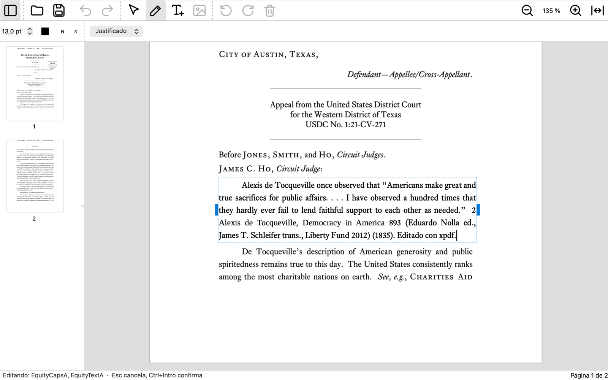
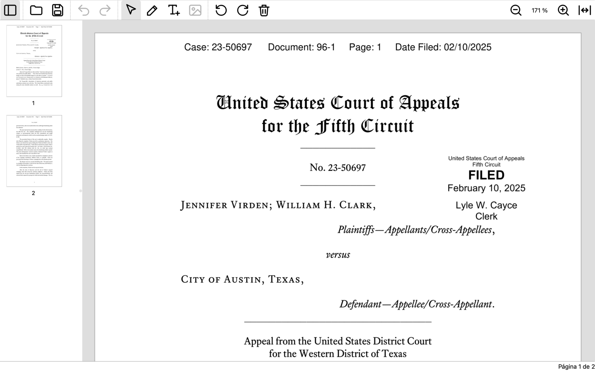

<div align="center">

# xpdf

**Editor de PDF de escritorio: pocas funciones, bien hechas.**

Edita el texto de un PDF en su sitio, con su misma letra, como si fuera un documento.
Gratuito, de código abierto y sin nube: tus PDFs no salen de tu ordenador.

[](LICENSE)




</div>

## Qué hace

**Editar texto existente (WYSIWYG).** Haz clic en un párrafo y escribe. xpdf
detecta párrafos, alineación (izquierda, centro, derecha, justificado), sangría e
interlineado, y vuelve a componer el texto dentro del mismo ancho. Negrita,
cursiva, tamaño y color por tramos. Arrastra los tiradores laterales para
ensanchar o estrechar la caja.

**La misma letra que el original.** xpdf escribe con *el propio objeto de fuente
del PDF* y con sus métricas exactas (anchos, espaciado y kerning medidos en el
documento). Las palabras que no cambias quedan donde estaban; el archivo no
crece. Solo los caracteres que no existen en la fuente incrustada (los PDFs
guardan únicamente las letras que usan) se toman de otra parecida, y xpdf te
dice cuáles.

**Añadir texto** en cualquier punto, con tipo de letra, tamaño, color y estilo.

**Páginas.** Reordenar arrastrando las miniaturas, girar y borrar, una o varias
a la vez. Se conservan formularios, marcadores y enlaces internos.

**Guardar sin engordar el archivo**, y *Archivo → Reducir tamaño…* para una
copia más ligera (sin pérdida, equilibrado o máxima reducción).

**Deshacer y rehacer** todo, incluso después de guardar. Nunca sobrescribe el
original sin preguntar.



## Instalación

### Windows

Abre **PowerShell** y pega:

```powershell
irm https://raw.githubusercontent.com/TU-USUARIO/xpdf/main/scripts/install.ps1 | iex
```

Descarga la última versión, comprueba su huella SHA-256 y la instala en tu
usuario (sin permisos de administrador), con acceso directo en el escritorio y
en el menú Inicio. También puedes bajar el instalador desde
[Releases](https://github.com/TU-USUARIO/xpdf/releases/latest).

### macOS (Apple Silicon)

```sh
curl -fsSL https://raw.githubusercontent.com/TU-USUARIO/xpdf/main/scripts/install.sh | sh
```

### Actualizaciones

xpdf comprueba al arrancar si hay una versión nueva y te pregunta antes de
instalarla. También en *Ayuda → Buscar actualizaciones*.

> **Sobre los avisos de seguridad.** xpdf no está firmado con un certificado de
> pago. Si descargas el instalador con el navegador, Windows puede mostrar
> «Windows protegió su PC» (*Más información → Ejecutar de todas formas*) y
> macOS puede pedir abrirlo con *clic derecho → Abrir* la primera vez. Con las
> líneas de arriba no suele aparecer. Cada versión publica sus sumas SHA-256.

## Uso rápido

| Acción | Atajo |
|---|---|
| Abrir · Guardar · Guardar como | Ctrl/⌘ + O · S · Mayús+S |
| Deshacer · Rehacer | Ctrl/⌘ + Z · Mayús+Z |
| Seleccionar · Editar texto · Añadir texto | V · E · T |
| Negrita · Cursiva (editando) | Ctrl/⌘ + B · I |
| Confirmar · Cancelar edición | Ctrl+Intro (o clic fuera) · Esc |
| Girar página izquierda · derecha | Ctrl/⌘ + L · R |
| Borrar páginas | Supr (en las miniaturas) |
| Zoom · Ajustar al ancho · Tamaño real | Ctrl/⌘ + / − · Ctrl/⌘ + 0 · Ctrl/⌘ + 1 |

También puedes arrastrar un PDF a la ventana para abrirlo.

## Limitaciones conocidas

xpdf prefiere no dejarte editar algo a estropearlo. Lo dice al hacer clic en:

- párrafos con **fórmulas matemáticas**, fuentes de **símbolos** (Wingdings…) o
  fuentes **Type3**;
- texto **vertical** y la capa invisible de **OCR** de los escaneados.

Además:

- Si un párrafo crece, se amplía hacia abajo y puede montarse sobre el
  siguiente (como en Acrobat); xpdf lo avisa y puedes ensanchar la caja.
- Escrituras que necesitan motor de forma (árabe, hebreo, índicas) usan una ruta
  de composición menos fiel al original.
- La vista previa mientras escribes usa el motor de texto del sistema: los
  cortes de línea pueden variar algo respecto al resultado final.

## Privacidad

xpdf funciona sin conexión. La única petición a Internet es la comprobación de
actualizaciones (a GitHub). Sin telemetría, sin cuentas. Los errores se guardan
solo en tu equipo:

- Windows: `%LOCALAPPDATA%\xpdf\xpdf.log`
- macOS: `~/Library/Application Support/xpdf/xpdf.log`

## Hoja de ruta

- Imágenes: añadir, mover, redimensionar, reemplazar y eliminar
- Formularios, firma, OCR de escaneados y cifrado (la arquitectura ya los prevé)

## Desarrollo

Requiere [uv](https://docs.astral.sh/uv/).

```sh
uv sync                  # entorno e instalación de dependencias
uv run xpdf [archivo]    # ejecutar
uv run pytest            # tests (incluye un corpus de PDFs reales)
uv run mypy              # tipos (modo estricto)
```

```
src/xpdf/
├── core/            lógica PDF (PyMuPDF), sin Qt — cubierta por tests
│   ├── text.py      detección de párrafos y edición
│   ├── layout.py    composición propia: partición, justificado, escritura
│   ├── pdffonts.py  escritura con las fuentes originales del PDF
│   ├── fonts.py     elección de fuentes y comprobación de glifos
│   ├── pages.py     borrar, girar y reordenar páginas
│   ├── optimize.py  «Reducir tamaño…»
│   └── editing.py   fachada para la interfaz
└── ui/              PySide6 — nunca llama a PyMuPDF directamente
tests/samples/       corpus de PDFs reales (Word, LaTeX, formularios, OCR…)
packaging/           PyInstaller (xpdf.spec) e instalador de Windows (Inno Setup)
scripts/             instaladores de una línea (install.ps1, install.sh)
tools/               icono de la app y ayuda para publicar versiones
```

La interfaz y el núcleo están separados: todo lo que toca el PDF vive en `core/`
y se prueba sin interfaz gráfica.

### Compilar el ejecutable

```sh
uv run python build.py
```

Genera en `dist/` el paquete del sistema actual (PyInstaller en modo carpeta,
sin UPX) y lo comprueba con `--selftest`: en Windows, el instalador
`xpdf-<versión>-windows-x64-setup.exe` (necesita [Inno Setup 6](https://jrsoftware.org/isinfo.php));
en macOS, `xpdf-<versión>-macos-arm64.zip`. No se puede compilar para Windows
desde macOS ni al revés: para eso está la integración continua.

### Publicar una versión

```sh
uv run python tools/release.py 0.3.1      # sube la versión, pasa tests, commit y etiqueta
git push && git push origin v0.3.1        # GitHub Actions compila y publica
```

El workflow `release.yml` compila en Windows y macOS, ejecuta la
autocomprobación sobre cada ejecutable y publica en GitHub Releases junto con
`SHA256SUMS.txt`. Las copias instaladas lo detectan al arrancar.

## Licencia

[AGPL-3.0-or-later](LICENSE). xpdf usa [PyMuPDF](https://pymupdf.readthedocs.io)
(AGPL) y [PySide6](https://doc.qt.io/qtforpython-6/) (LGPL), e incluye las fuentes
[Liberation](https://github.com/liberationfonts/liberation-fonts) (SIL OFL 1.1)
como respaldo. Los PDFs de prueba tienen su origen y licencia en
[`tests/samples/README.md`](tests/samples/README.md).
